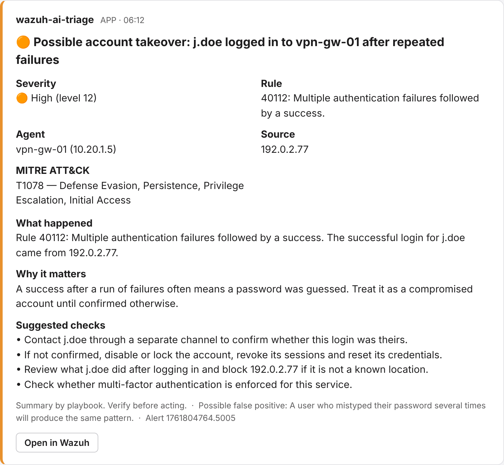
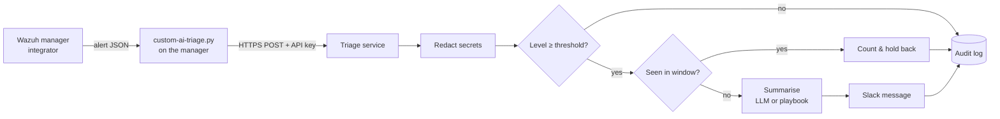

# Wazuh alerts → Slack, triaged

[](https://github.com/arafathossein/wazuh-alerts-to-slack-ai/actions/workflows/tests.yml)

**Fewer, clearer security alerts.** A small service that receives alerts from a [Wazuh](https://wazuh.com) manager, strips secrets out of them, merges repeats, and posts a short Slack message that says what happened, why it matters and what to check next. Summaries come from your choice of language model — including one running on your own hardware — or from built-in playbooks with no model at all.

It advises; it never acts. Every message ends with *verify before acting*, and nothing in this project blocks, deletes or changes anything.

Built by [AFYRA Technologies](https://afyra-iota.vercel.app).



*Rendered from the real Block Kit payload for [`samples/alerts/05_secret_in_log.json`](samples/alerts/05_secret_in_log.json). The password, token and email address in that alert's log line never reach the message or the model.*

## Why

Wazuh is good at detecting things. On a busy network it also produces more alerts than a small team can read, and the raw ones assume you know what rule 40112 means at three in the morning. The common fix — piping alerts straight into a chat channel — makes it worse: hundreds of near-identical messages, and log lines full of passwords and tokens pasted where everyone can see them.

This project sits in between and does four things:

| | |
| --- | --- |
| **Redacts** | Passwords, bearer tokens, API keys, AWS keys, private keys and email addresses are removed from the log text before anything else sees it. Internal IP addresses can be masked too. |
| **De-duplicates** | One message per rule, host and source per window (default 10 minutes). Repeats are counted, and the next message says how many were held back. A long attack still escalates every 50 repeats, so it never goes silent. |
| **Explains** | A headline, what happened, why it matters, 2–4 concrete checks and a false-positive hint — tied to the alert's real IPs, users and files. |
| **Records** | Every alert, including suppressed and below-threshold ones, is written to an audit log with the decision taken. |

## How it works



Wazuh's integrator calls a small, standard-library-only script for each alert at or above the configured level. The script posts the alert to the triage service and exits — it adds nothing to install on the manager and never holds Wazuh up for long.

## What the summaries cover

Built-in playbooks handle the alert families that fill most queues:

| Alert family | Example rules | Message leads with |
| --- | --- | --- |
| Login succeeded after failures | 40112 | Possible account takeover — confirm with the user, lock if unconfirmed |
| Brute force | 5712, 5720, 5763 | Check for a later successful login from the same source; block it |
| File integrity | 550, 554 | Was this change planned? Who made it? |
| Web attacks | 31103 and friends | Did the server answer 200? Review app logs |
| Malware / rootcheck | rootcheck, VirusTotal, YARA groups | Isolate, hash, escalate |
| Privilege use | 5402 | Was this user expected to use sudo now? |
| Vulnerabilities | vulnerability-detector | Patch priority by exposure |

Anything else gets a generic summary from the rule's own metadata. With a model configured, it writes the summary instead, from the redacted alert only, and is told never to invent facts or claim an action was taken. If the model fails or returns something malformed, the playbook is used and the message says so.

## Quick start

### Try it without Wazuh or Slack

```bash
python -m venv .venv && source .venv/bin/activate      # Windows: .venv\Scripts\activate
pip install -e ".[dev]"

wazuh-ai-triage triage --fresh samples/alerts/*.json   # prints each message
wazuh-ai-triage slack-json samples/alerts/02_fim_etc_passwd.json   # the exact Slack payload
pytest                                                 # 36 tests
```

### Run the service

```bash
cp .env.example .env    # set SLACK_WEBHOOK_URL and a long random SERVICE_API_KEY
docker compose up -d --build
curl http://127.0.0.1:8080/health
```

Without Docker: `wazuh-ai-triage serve --host 127.0.0.1 --port 8080`.

### Connect your Wazuh manager

On the manager (tested against the integrator's argument contract: `<alert_file> <api_key> <hook_url>`):

```bash
sudo cp integration/custom-ai-triage.py /var/ossec/integrations/
sudo chmod 750 /var/ossec/integrations/custom-ai-triage.py
sudo chown root:wazuh /var/ossec/integrations/custom-ai-triage.py
```

Add the block from [`integration/ossec.conf.snippet.xml`](integration/ossec.conf.snippet.xml) inside `<ossec_config>` in `/var/ossec/etc/ossec.conf`, with the same API key as the service:

```xml
<integration>
  <name>custom-ai-triage.py</name>
  <hook_url>http://127.0.0.1:8080/wazuh/alert</hook_url>
  <api_key>CHANGE_ME_LONG_RANDOM_STRING</api_key>
  <level>7</level>
  <alert_format>json</alert_format>
</integration>
```

```bash
sudo systemctl restart wazuh-manager
```

If messages don't arrive, check `/var/ossec/logs/integrations.log` (the script writes its errors there) and `/var/ossec/logs/ossec.log`.

## Keeping data private

- **No model needed.** The playbooks cover the common cases and nothing leaves your network except the Slack message.
- **Local model.** Point `LLM_BASE_URL` at Ollama, vLLM or LM Studio and alerts never reach a third party.
- **Hosted model.** Only the redacted, normalised alert is sent — never the raw event — and you choose the provider.
- **Masking.** `MASK_PRIVATE_IPS=true` replaces internal addresses (10/8, 172.16/12, 192.168/16, loopback, link-local, CGNAT) with `[internal-ip]`. Public source addresses are kept, because those are what you block.

## Configuration

| Variable | Default | Meaning |
| --- | --- | --- |
| `SLACK_WEBHOOK_URL` | — | Slack incoming webhook; empty prints to console |
| `WAZUH_DASHBOARD_URL` | — | Adds an "Open in Wazuh" button |
| `SERVICE_API_KEY` | — | Required `X-API-Key` header if set |
| `MIN_LEVEL` | `7` | Alerts below this level are audited, not sent |
| `THROTTLE_WINDOW_SECONDS` | `600` | De-duplication window per rule + host + source |
| `ESCALATE_EVERY` | `50` | Send an update after this many held-back repeats |
| `MASK_PRIVATE_IPS` | `false` | Mask internal IP addresses |
| `LLM_BASE_URL` / `LLM_API_KEY` / `LLM_MODEL` | — | Optional OpenAI-compatible model |

## Testing

36 tests cover parsing, every redaction pattern, severity bands, playbook routing for each sample, throttling and escalation, model success and fallback (mocked, including a check that secrets are gone from the model request), the Slack payload, the API, and the integration script run exactly as Wazuh runs it against a live HTTP endpoint.

The five sample alerts in [`samples/alerts/`](samples/alerts/) are fictional and use documentation IP ranges. Their structure follows Wazuh's JSON alert format; rule numbers and descriptions follow Wazuh's default ruleset but may differ slightly between versions.

## Project layout

```
integration/          custom-ai-triage.py (runs on the manager) + ossec.conf block
src/wazuh_ai_triage/
  parse.py            Wazuh alert JSON → normalised Alert
  redact.py           secret, email and internal-IP removal
  playbooks.py        rule-based summaries for common alert families
  summarize.py        OpenAI-compatible model with playbook fallback
  throttle.py         de-duplication window and escalation
  notify.py           Slack Block Kit / console
  service.py, api.py  pipeline and HTTP endpoint
samples/alerts/       fictional alerts
docs/preview.png      rendered example message
```

## Roadmap

- Microsoft Teams and email delivery
- Group related alerts across rules (e.g. brute force → success → sudo on one host)
- Optional enrichment from threat-intelligence lookups
- Weekly digest of suppressed noise, to tune rules

## License

MIT — see [LICENSE](LICENSE).
